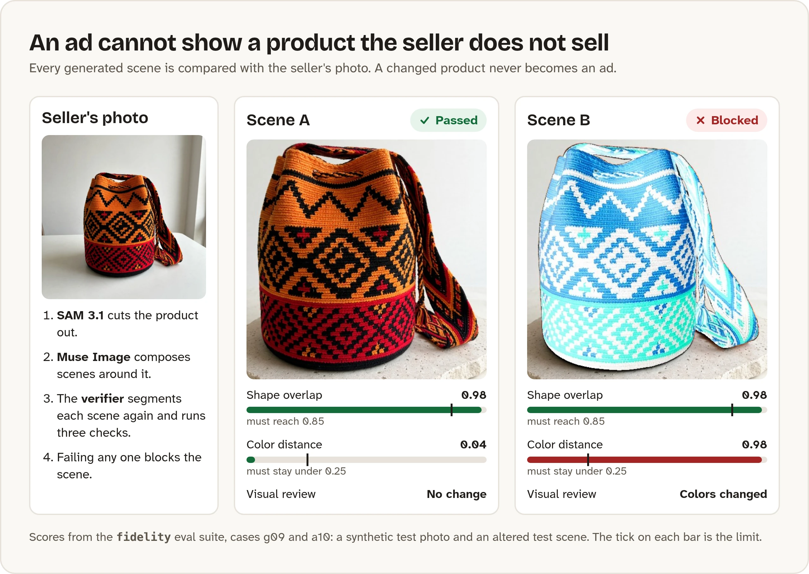
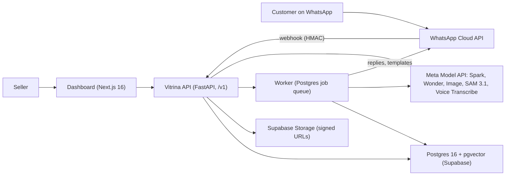
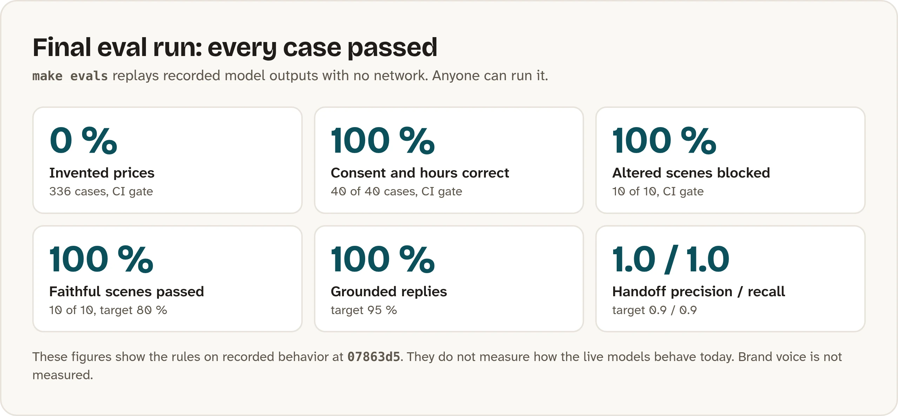

<p>
  <picture>
    <source media="(prefers-color-scheme: dark)" srcset="docs/brand/lockup-dark.svg">
    
  </picture>
</p>

# Vitrina

> **Tus fotos se vuelven anuncios, tus anuncios se vuelven ventas, y cada conversación mejora el próximo anuncio.**
> Your photos become ads, your ads become sales, and every conversation improves the next ad.

Vitrina is a closed-loop AI storefront for WhatsApp sellers in Colombia, built in the open during the **Meta Global AI Developer Hackathon** (Indie Developer Track, theme "Build for Your World"), October 26 – November 4, 2026.

**Judges:** start with [JUDGING.md](JUDGING.md), a ten-minute path in English.

**Status:** the hackathon deployment is offline. The public "Foto → Vitrina" page at `/foto` turned one product photo into a shareable showcase, with no account.

<picture>
  <source media="(prefers-color-scheme: dark)" srcset="docs/infographics/loop-dark.webp">
  
</picture>

| At a glance | |
| --- | --- |
| **For** | Small sellers in Colombia who sell on WhatsApp |
| **Starts from** | Phone photos and a price list |
| **Gives them** | Ads checked against the real product, a sales agent that answers only from their catalog, and a weekly brief on which ad to make next |
| **Try it** | The hackathon deployment is offline and its shared demo account is closed. The [ten-minute guide](JUDGING.md) describes what it showed. The demo used Meta's WhatsApp test number, so visitors played the customer in the dashboard |

## What it does

1. **Catalog.** The seller pastes prices and FAQ and uploads two or three phone photos per product. A menu photo can be imported as draft products, which the seller approves before the agent may cite them.
2. **Creative.** SAM 3.1 cuts the product out of the photo, Muse Image composes ad scenes (story 9:16, catalog 1:1), and a fidelity verifier segments every scene again and blocks any image that changes the real product's shape, color or logo. Muse Spark writes a hook × angle grid of copy in the seller's voice. Each approved ad gets a short code (`#A7`) and a `wa.me` link.
3. **Conversation.** A sales agent on Muse Spark answers customers in text, photos and voice notes, only from the seller's catalog, citing the facts it used. A price validator rejects any amount that is not in the cited facts. When the agent cannot answer, it hands off to the seller with a summary.
4. **Learning.** Objections (price, shipping, size, availability, trust, timing, payment) are recorded per ad. Each week Muse Wonder turns them, with the ad → chat attribution, into a brief that drives the next ads.
5. **Reactivation.** Contacts are messaged again only with recorded consent, inside Colombia's legal marketing hours, through approved templates. Every send decision is logged with its reason.

## What makes it different

- **Validators run outside the model.** The price validator, groundedness and confidence rules, handoff checks and a scope classifier decide what is sent, whatever the model returns.
- **The fidelity verifier gates every generated image.** It combines mask overlap (IoU), color histogram distance and a visual review. An ad cannot show a product the seller does not sell.
- **Attribution is a first-class fact.** `ad → chat → outcome` is queryable per ad and per angle.
- **The consent ledger is append-only.** It stores the exact text shown and the customer's literal answer. Silence never counts as consent, and no API call can override the legal-hours scheduler.
- **The evaluation harness lives in the API.** CI replays recorded model outputs and fails on a single invented price or consent error, or on a missed target.

The agent is scoped to one seller's business and declines everything else, in line with WhatsApp's policy on general-purpose assistants.

<picture>
  <source media="(prefers-color-scheme: dark)" srcset="docs/infographics/reply-dark.webp">
  
</picture>

<picture>
  <source media="(prefers-color-scheme: dark)" srcset="docs/infographics/fidelity-dark.webp">
  
</picture>

## Architecture



The contracts are frozen in `specs/001-vitrina-api/contracts/`: `openapi.yaml` for the HTTP API and `agent-tools.json` for the agent's tools. CI fails when the running API drifts from them.

## Meta models used

| Model | Role in Vitrina | Where in code | Model ID |
| --- | --- | --- | --- |
| Muse Spark | Sales agent (tool calling plus strict JSON output), scope classifier, copywriter, brand-voice judge, visual review, menu import | `packages/conversation`, `packages/creative`, `packages/catalog` | `muse-spark-1.3` |
| Muse Wonder | Weekly brief from objections and attribution | `packages/learning` | `muse-wonder-1.0` |
| Muse Image | Ad scenes from the product cutout | `packages/creative` | `muse-image-1.0` |
| SAM 3.1 | Product segmentation and re-segmentation for the verifier | `packages/creative` | `sam-3.1` |
| Muse Voice Transcribe | Spanish voice notes to text | `packages/conversation` | `muse-voice-transcribe-1.0` |

All five models are called through `providers/meta_model_api` and configured by `MODEL_*` settings. Every call is logged with provider, model, tokens, latency and cost, and is visible at `GET /v1/metrics/costs` and on the dashboard's metrics page. Muse Glimmer (open weights, self-hosted) and Spark Open on Baseten have adapter slots in `providers/` and are not wired yet.

## Built during the hackathon

Constitution Article I: every line of product code was committed after the kickoff (Mon Oct 26, 12:00 ET). Pre-kickoff work was limited to accounts, provider setup and documents. `git log --date=iso --format='%ad %s'` is the ground truth.

| Date | What landed |
| --- | --- |
| Oct 26, 12:00 ET | Kickoff |
| Oct 27 | Constitution, spec and frozen contracts. Then the uv workspace, CI (lint, types, tests, contract drift, replay evals, image smoke test) and the core: settings, auth, problem+json errors, idempotency, job queue, model-call ledger, blob storage. Catalog with hybrid search and menu import. Creative pipeline (segment, compose, verify, copy grid, brand-voice judge, ads with codes). Compliance (legal-hours calendar, eligibility order, consent ledger, opt-out, erasure) and its eval suite. Price validator and answer review. Dashboard pages for catalog, creatives, ads, conversations and metrics, plus the public "Foto → Vitrina" showcase |
| Oct 28 | Agent loop and `POST /agent/turns`. Inbound pipeline from webhook to reply, with voice notes, photos, off-topic declines and handoffs. Live adapters for Muse Image, SAM 3.1 and Voice Transcribe. First fully live creative job: 6 of 6 scenes passed the verifier, 10 copy variants. Live agent turns on Spark with cited replies. Dashboard pages for contacts, campaigns and the weekly brief |
| Oct 29 | Price check reads more Colombian price forms ("palos", spelled short prices, lists of prices). Consent: Colombian yeses, longer opt-out requests, and an opt-out that wins over a later yes. The first fallback hands the chat to the owner. Hardening: request size limits, pixel-bomb refusal, media downloads, security headers. Vitrina's logo, type and design tokens. Deploy scripts and the demo-shop seed |
| Oct 30 – Nov 1 | Deployed: API and workers on Azure Container Apps, dashboard on Cloudflare Workers, database and storage on Supabase |
| Nov 3 | Fixes from a full code audit. Seller creation needs a service token. The price and offer check fails closed. Daily limits and a spend limit on paid model calls. Customer messages get their own worker. Stuck creative jobs end. Large photos are verified in memory and kept upright. The seller reads and answers a conversation in the dashboard. Eval runs fail below target |
| Nov 4 | Every customer message ends in a reply or a handoff, even after a failed attempt. A retry resumes the reply already made. A send that fails opens a handoff for the owner. Final eval run |

## Evaluation

<picture>
  <source media="(prefers-color-scheme: dark)" srcset="docs/infographics/results-dark.webp">
  
</picture>

The suites live in `evals/fixtures`: Spanish conversations, consent and scheduler cases, and webhook payloads. `make evals` replays recorded model outputs with no network.

Final run: `make evals` on `main` at `07863d5`, November 4, 2026, in replay mode. Every case passed in all four suites.

| Metric | Target | Result |
| --- | --- | --- |
| Invented-price rate | 0 % (CI gate) | 0 % (conversations 60 cases, price check 276 cases) |
| Consent scheduler cases | 100 % (CI gate) | 100 % (40 of 40) |
| Groundedness rate | ≥ 95 % (CI gate) | 100 % |
| Handoff precision / recall | ≥ 0.9 / ≥ 0.9 (CI gate) | 1.0 / 1.0 |
| Off-topic refusal rate | — | 100 % |
| Brand-voice mean | ≥ 4.0 / 5 | not measured: no suite computes it yet |
| Verifier: pass on good scenes / block on altered scenes | ≥ 80 % / 100 % (CI gate) | 100 % / 100 % (20 scenes) |

Replay plays back model outputs recorded from live calls, so these figures show the validators and rules on recorded behavior. They do not measure how the live models behave today.

## Legal by design

<picture>
  <source media="(prefers-color-scheme: dark)" srcset="docs/infographics/consent-dark.webp">
  
</picture>

- **Ley 1581 de 2012 and Decreto 1377 de 2013.** Prior, express, informed consent is recorded verbatim. A contact without consent is `blocked` with `NO_CONSENT_LEY_1581`.
- **Ley 2300 de 2023.** Marketing is sent only Monday–Friday 07:00–19:00 and Saturday 08:00–15:00 (America/Bogota), never on Sundays or public holidays. Outside the window a send is `deferred` with `next_allowed_at`.
- **Ley 1480 de 2011.** There are no misleading creatives: altered images are blocked, and generated images carry provenance metadata and the "imagen generada con IA" label.
- **WhatsApp Business policies.**
  - The agent is scoped to the seller's business.
  - Templates are used outside the 24-hour window.
  - Messages to one recipient are spaced at least 6 s apart.
  - `BAJA` opts out at once, and `BORRAR MIS DATOS` erases the customer's data within 24 hours.

## Known limits

- **WhatsApp test number.** The business behind this demo is not verified with Meta. The demo and the deployment use Meta's WhatsApp test number, which can message only verified recipients (up to five). Running the WhatsApp Business app and the Cloud API on one number (coexistence) is out of scope: it needs a verified business and a Tech Provider.
- **Price and offer check.** The check fails closed on the forms it recognises: amounts, currencies, percentages, 2x1, instalments, discounts and free shipping must come from a cited fact. It does not catch every invented price. Still passing: an uncited product name next to a cited price, a bundle such as "Las dos te quedan en $85.000", and slang or spelled-out amounts it does not read.
- **Reply after a crash.** A failed attempt now ends in a reply or a handoff. If the process dies after a reply was sent but before it was recorded, the reply is not sent again: the customer may not get it, and the owner gets a handoff with its text. A turn re-run after a crash runs its tools again, so a reservation can be held twice until the extra hold expires.
- **Photo metadata.** Stored photos that need no rotation keep their EXIF data, including any GPS location. Only the signed-in seller can reach them. A public showcase never serves the upload: its scenes are new images, and the upload is deleted when the job ends.
- **Eval runs.** `GET /evals/runs` lists every seller's runs to any signed-in seller.
- **Handoff summaries.** When the agent hands a chat to the owner, the summary goes to the dashboard's waiting list, not to the owner's own WhatsApp.
- **Consent wording.** The consent and opt-out texts follow Ley 1581 and Ley 2300, but no lawyer has reviewed them.
- **Search.** No embedding model is available to our key, so catalog search runs on full text, trigrams and Spanish word stems.

## Run it locally (no keys needed)

No `.env` and no account are needed for any of this. It takes `uv` and, for the dashboard, `pnpm`.

```
git clone https://github.com/alined-labs/vitrina && cd vitrina
make sync          # install the uv workspace exactly as locked
make check         # ruff, mypy, pytest without live providers, contract drift
make evals         # replay the recorded suites; fails on an invented price, a consent error or a missed target
```

`make evals` sets the model IDs and request settings the recordings were made with, so a `.env` of your own causes no replay miss.

The API starts with no settings, but then seller routes answer 401: it has nothing to check a token against. A local secret of 32 bytes or more is enough, and `make dev-token` signs a seller token with it. Creating a seller also needs a local `SERVICE_TOKEN`, sent in `X-Service-Token`. Stores are in memory, so the seller is gone when the API stops.

```
export SUPABASE_JWT_SECRET=$(openssl rand -hex 32)   # the same values in both terminals
export SERVICE_TOKEN=$(openssl rand -hex 32)
make api                                             # first terminal: the API on :8000

# second terminal
export TOKEN=$(make dev-token)
curl -H "Authorization: Bearer $TOKEN" -H "X-Service-Token: $SERVICE_TOKEN" -H "Content-Type: application/json" \
  -d '{"business_name":"Tienda de prueba","owner_name":"Ana","whatsapp_number":"+573000000000","city":"Medellín"}' \
  http://localhost:8000/v1/sellers                   # until then, seller routes answer 403
curl -H "Authorization: Bearer $TOKEN" http://localhost:8000/v1/sellers/me
cd apps/dashboard && pnpm install && NEXT_PUBLIC_DEV_ACCESS_TOKEN=$TOKEN pnpm dev   # on :3000
```

What this local run does not do:

- **Replay answers only what was recorded.** A recording is found by a hash of the whole request, so a new customer message has none: the agent replies "No tengo ese dato" and hands off to the owner. The recorded conversations play in `make evals`.
- **`/mock/whatsapp` is a read-only viewer.** It shows what the local messenger sent, which is nothing in these steps. You cannot type a customer message there.
- **No jobs.** `make worker` refuses to start without a database, and replay sessions answer 503.

Live mode needs a Meta Model API key (`META_API_KEY`, `MODEL_*`), a WhatsApp Cloud API number and a Supabase project. `.env.example` lists every setting by name.

## Project structure

- `apps/api` (FastAPI routers), `apps/worker` (jobs), `apps/dashboard` (Next.js, typed client generated from `openapi.yaml`)
- `packages/{core,catalog,creative,conversation,compliance,learning,evals}`
- `providers/{meta_model_api,whatsapp,local_mock,modal_glimmer,baseten}`
- `docs/infographics` (the images in this README: `source.html`, rendered by `render.sh`)
- `evals/fixtures` (recorded cases), `specs/001-vitrina-api/` (spec, plan, tasks, contracts), `constitution.md`, `AGENTS.md`

## Credits

The following third-party and open-source components are separate from our own work:
- **Python:** FastAPI, Uvicorn, Pydantic, SQLAlchemy, Alembic, asyncpg, pgvector, the OpenAI Python SDK (as the client for Meta's OpenAI-compatible API), meta-sam-parser, Pillow, NumPy, `holidays`, PyJWT, Hypothesis, pytest, Ruff, mypy.
- **Dashboard:** Next.js, React, Tailwind CSS, Supabase JS, openapi-fetch, openapi-typescript.
- **Media:** ffmpeg.
- **Models:** Muse Spark, Muse Wonder, Muse Image, SAM 3.1 and Muse Voice Transcribe, by Meta.

## License

MIT.
