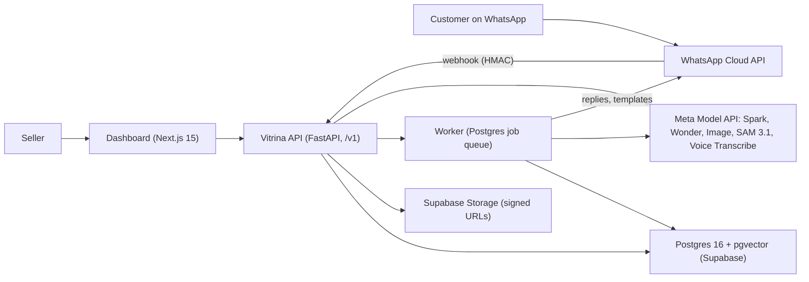

# Vitrina

> **Tus fotos se vuelven anuncios, tus anuncios se vuelven ventas, y cada conversación mejora el próximo anuncio.**
> Your photos become ads, your ads become sales, and every conversation improves the next ad.

Vitrina is a closed-loop AI storefront for WhatsApp sellers in Colombia, built in the open during the **Meta Global AI Developer Hackathon** (Indie Developer Track, theme "Build for Your World"), October 26 – November 4, 2026.

## What it does

1. **Catalog.** The seller pastes prices and FAQ and uploads two or three phone photos per product. A menu photo can be imported as draft products, which the seller approves before the agent may cite them.
2. **Creative.** SAM 3.1 cuts the product out of the photo, Muse Image composes ad scenes (story 9:16, catalog 1:1), and a fidelity verifier segments every scene again and blocks any image that changes the real product's shape, color or logo. Muse Spark writes a hook × angle grid of copy in the seller's voice. Each approved ad gets a short code (`#A7`) and a `wa.me` link.
3. **Conversation.** A sales agent on Muse Spark answers customers in text, photos and voice notes, only from the seller's catalog, citing the facts it used. A price validator rejects any amount that is not in the cited facts. When the agent cannot answer, it hands off to the seller with a summary.
4. **Learning.** Objections (price, shipping, size, availability, trust, timing, payment) are recorded per ad. Each week Muse Wonder turns them, with the ad → chat attribution, into a brief that drives the next ads.
5. **Reactivation.** Contacts are messaged again only with recorded consent, inside Colombia's legal marketing hours, through approved templates. Every send decision is logged with its reason.

## What makes it different

- **Validators run outside the model.** The price validator, groundedness and confidence rules, handoff checks and a scope classifier decide what is sent, whatever the model returns.
- **The fidelity verifier gates every generated image.** It combines mask overlap (IoU), color histogram distance and a visual review. An ad cannot show a product the seller does not sell.
- **Attribution is a first-class fact.** `ad → chat → outcome` is queryable per ad and per angle.
- **The consent ledger is append-only.** It stores the exact text shown and the customer's literal answer. Silence never counts as consent, and no API call can override the legal-hours scheduler.
- **The evaluation harness lives in the API.** CI replays recorded model outputs and fails on a single invented price or consent error.

The agent is scoped to one seller's business and declines everything else, in line with WhatsApp's policy on general-purpose assistants.

## Architecture



The contracts are frozen in `specs/001-vitrina-api/contracts/`: `openapi.yaml` for the HTTP API and `agent-tools.json` for the agent's tools. CI fails when the running API drifts from them.

## Meta models used

| Model | Role in Vitrina | Where in code | Model ID |
| --- | --- | --- | --- |
| Muse Spark | Sales agent (tool calling plus strict JSON output), scope classifier, copywriter, brand-voice judge, visual review, menu import | `packages/conversation`, `packages/creative`, `packages/catalog` | `muse-spark-1.3` |
| Muse Wonder | Weekly brief from objections and attribution | `packages/learning` | `muse-wonder-1.0` |
| Muse Image | Ad scenes from the product cutout | `packages/creative` | `muse-image-1.0` |
| SAM 3.1 | Product segmentation and re-segmentation for the verifier | `packages/creative` | `sam-3.1` |
| Muse Voice Transcribe | Spanish voice notes to text | `packages/conversation` | `muse-voice-transcribe-1.0` |

All five models are called through `providers/meta_model_api` and configured by `MODEL_*` settings. Every call is logged with provider, model, tokens, latency and cost, and is visible at `GET /v1/metrics/costs` and on the dashboard's metrics page. Muse Glimmer (open weights, self-hosted) and Spark Open on Baseten have adapter slots in `providers/` and are not wired yet.

## Built during the hackathon

Constitution Article I: every line of product code was committed after the kickoff (Mon Oct 26, 12:00 ET). Pre-kickoff work was limited to accounts, provider setup and documents. `git log --date=iso --format='%ad %s'` is the ground truth.

| Date | What landed |
| --- | --- |
| Oct 26, 12:00 ET | Kickoff |
| Oct 27 | Constitution, spec and frozen contracts. Then the uv workspace, CI (lint, types, tests, contract drift, replay evals, image smoke test) and the core: settings, auth, problem+json errors, idempotency, job queue, model-call ledger, blob storage. Catalog with hybrid search and menu import. Creative pipeline (segment, compose, verify, copy grid, brand-voice judge, ads with codes). Compliance (legal-hours calendar, eligibility order, consent ledger, opt-out, erasure) and its eval suite. Price validator and answer review. Dashboard pages for catalog, creatives, ads, conversations and metrics, plus the public "Foto → Vitrina" showcase |
| Oct 28 | Agent loop and `POST /agent/turns`. Inbound pipeline from webhook to reply, with voice notes, photos, off-topic declines and handoffs. Live adapters for Muse Image, SAM 3.1 and Voice Transcribe. First fully live creative job: 6 of 6 scenes passed the verifier, 10 copy variants. Live agent turns on Spark with cited replies. Dashboard pages for contacts, campaigns and the weekly brief |

## Evaluation

The suites live in `evals/fixtures`: Spanish conversations, consent and scheduler cases, and webhook payloads. `make evals` replays recorded model outputs with no network. Results of the final run are added here at feature freeze.

| Metric | Target |
| --- | --- |
| Invented-price rate | 0 % (CI gate) |
| Consent scheduler cases | 100 % (CI gate) |
| Groundedness rate | ≥ 95 % |
| Handoff precision / recall | ≥ 0.9 / ≥ 0.9 |
| Brand-voice mean | ≥ 4.0 / 5 |
| Verifier: pass on good scenes / block on altered scenes | ≥ 80 % / 100 % |

## Legal by design

- **Ley 1581 de 2012 and Decreto 1377 de 2013.** Prior, express, informed consent is recorded verbatim. A contact without consent is `blocked` with `NO_CONSENT_LEY_1581`.
- **Ley 2300 de 2023.** Marketing is sent only Monday–Friday 07:00–19:00 and Saturday 08:00–15:00 (America/Bogota), never on Sundays or public holidays. Outside the window a send is `deferred` with `next_allowed_at`.
- **Ley 1480 de 2011.** There are no misleading creatives: altered images are blocked, and generated images carry provenance metadata and the "imagen generada con IA" label.
- **WhatsApp Business policies.**
  - The agent is scoped to the seller's business.
  - Templates are used outside the 24-hour window.
  - Messages to one recipient are spaced at least 6 s apart.
  - `BAJA` opts out at once, and `BORRAR MIS DATOS` erases the customer's data within 24 hours.

## Run it locally (no keys needed)

```
git clone https://github.com/alined-labs/vitrina && cd vitrina
make sync          # install the uv workspace exactly as locked
make check         # ruff, mypy, pytest without live providers, contract drift
make evals         # replay the suites; fails on an invented price or a consent error
make api           # the API on :8000; with no settings it runs in replay mode on the local WhatsApp mock
cd apps/dashboard && pnpm install && pnpm dev
```

With `REPLAY=true` every provider answers from its recorded cassette. Live mode needs a Meta Model API key (`META_API_KEY`, `MODEL_*`), a WhatsApp Cloud API number and a Supabase project. `.env.example` lists every setting by name. `make dev-token` gives the dashboard a local seller token without Supabase.

## Project structure

- `apps/api` (FastAPI routers), `apps/worker` (jobs), `apps/dashboard` (Next.js, typed client generated from `openapi.yaml`)
- `packages/{core,catalog,creative,conversation,compliance,learning,evals}`
- `providers/{meta_model_api,whatsapp,local_mock,modal_glimmer,baseten}`
- `evals/fixtures` (recorded cases), `specs/001-vitrina-api/` (spec, plan, tasks, contracts), `constitution.md`, `AGENTS.md`

## Credits

The following third-party and open-source components are separate from our own work:
- **Python:** FastAPI, Uvicorn, Pydantic, SQLAlchemy, Alembic, asyncpg, pgvector, the OpenAI Python SDK (as the client for Meta's OpenAI-compatible API), meta-sam-parser, Pillow, NumPy, `holidays`, PyJWT, Hypothesis, pytest, Ruff, mypy.
- **Dashboard:** Next.js, React, Tailwind CSS, Supabase JS, openapi-fetch, openapi-typescript.
- **Media:** ffmpeg.
- **Models:** Muse Spark, Muse Wonder, Muse Image, SAM 3.1 and Muse Voice Transcribe, by Meta.

## License

MIT.
